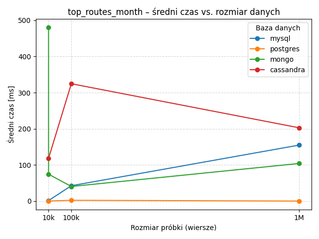
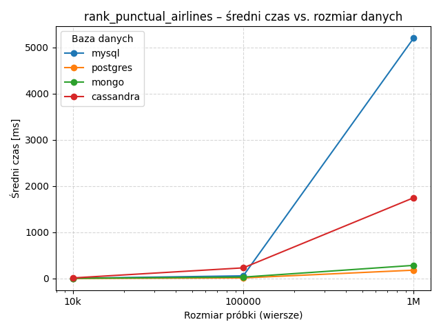

# db-bench-flights

Reproducible benchmark comparing **PostgreSQL, MySQL, MongoDB and Cassandra** on real-world flight data (10k / 100k / 1M rows) across CRUD and analytical query scenarios.

Every database runs in Docker with **identical resource limits (2 CPUs / 4 GB RAM)**, each scenario is repeated 12 times, and all timings (1,000+ measurements) are collected into a single CSV for analysis and plotting.

## Key results (median latency, 1M-row dataset)

| Scenario | PostgreSQL | MySQL | MongoDB | Cassandra |
|---|---:|---:|---:|---:|
| Insert single flight | **0.9 ms** | 2.2 ms | 6.4 ms | 2.6 ms |
| Insert flight performance stats | **1.1 ms** | 2.8 ms | 4.1 ms | 2.7 ms |
| Route lookup + stats | **1.3 ms** | 11.6 ms | 4.5 ms | 1 623 ms |
| Arrival-delay histogram | **235 ms** | 739 ms | 632 ms | 7 081 ms |
| Rank airlines by punctuality | **178 ms** | 5 156 ms | 284 ms | 1 686 ms |
| Top routes per month | **38 ms** | 33 951 ms | 188 ms | 2 304 ms |

Additional scenarios cover batch insert, bulk update/delete and per-carrier daily reads (MongoDB/Cassandra). Full data: [`runner/results/results.csv`](runner/results/results.csv), charts for every scenario in [`runner/results/charts/`](runner/results/charts/).




### Takeaways

- **PostgreSQL** dominated both point operations and ad-hoc analytics at this scale — including a ~900× lead over MySQL on the grouped "top routes" aggregation (38 ms vs 34 s).
- **MongoDB** held a solid middle ground on aggregation-pipeline analytics, at the cost of slower single-document inserts.
- **Cassandra** performed as designed: fine for writes and key-based access patterns, but orders of magnitude slower on ad-hoc analytical queries it was never built for — a good illustration of "pick the database for the query pattern, not the hype".
- Results come from a single-node Docker setup and reflect **relative behaviour under equal constraints**, not absolute production performance (see limitations below).

## How it works

```
docker/          per-database images, schemas and init scripts
  postgres/ mysql/ cassandra/ mongo/
runner/          Python benchmark harness
  bench_runner.py        orchestrates: sampling -> import -> scenarios -> results.csv
  bench_config.yml       databases, dataset sizes, repeats, query definitions
  bench_<db>.py          per-database scenario implementations
  sql_import/ nosql_import/   dataset import pipelines
  make_samples.py        builds randomized 10k/100k/1M samples from the raw CSV
  plot_results.py        renders per-scenario charts from results.csv
run_full_bench.sh  one-command full run
```

Each run: builds randomized samples from the source dataset → imports them into all four databases → executes every scenario 12× per dataset size → appends timings to `results.csv` → charts.

## Quick start

Requirements: Docker + Docker Compose. Place a flight dataset CSV (e.g. US DOT on-time performance data) at `data/raw/flight_data_2024.csv`.

```bash
cp .env.example .env
./run_full_bench.sh          # full pipeline: up -> import -> bench -> results
```

Or step by step:

```bash
docker compose up -d
docker exec -it dbbench-cassandra cqlsh -f /docker-entrypoint-initdb.d/schema.cql
docker compose exec runner bash -lc "cd /app && pip install -r requirements.txt && python bench_runner.py"
python runner/plot_results.py
```

Configuration (databases, dataset sizes, repeat count, resource limits) lives in `runner/bench_config.yml` and `.env`.

## Limitations

- Single-node containers on one host — no clustering, so Cassandra can't show its horizontal-scaling strengths.
- Default engine tuning; no per-database query optimisation beyond indexes defined in the schemas.
- Latency measured client-side from the runner container (includes driver overhead).

## Stack

Python (pandas, NumPy, matplotlib), Docker Compose, PostgreSQL 18, MySQL 9.5, MongoDB 8.2, Cassandra 5.0, SQL/CQL schemas, custom benchmark runner.
